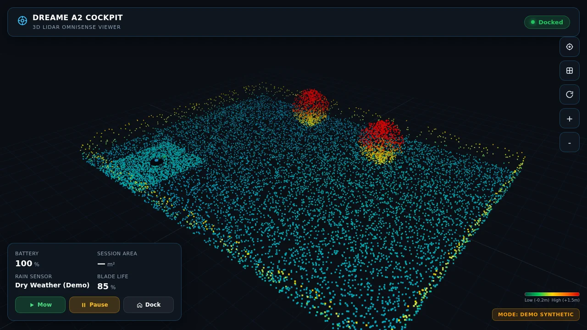

# Dreame A2 - Cockpit 3D LiDAR WebGL & Passerelle Home Assistant

[](LICENSE)
[](https://www.python.org/)
[](https://threejs.org/)
[](https://www.home-assistant.io/)

Visualiseur **3D LiDAR `.pcd` interactif** (Three.js r160 local sans CDN) et passerelle **FastAPI** découplée pour le robot tondeuse **Dreame Roboticmower A2** (OmniSense 2.0) sous Home Assistant.

- **English version:** [`README.md`](README.md) · **Changelog :** [`CHANGELOG.md`](CHANGELOG.md) · **Article complet :** [blog.ravindra-job.fr](https://blog.ravindra-job.fr/iot/dreame-a2-lidar-3d-pcd-passerelle-zero-trust-meteo-pluie/)



## Fonctionnalités

- **Nuage de points 3D hors-ligne :** Rendu `.pcd` WebGL avec `three@0.160.0` + `OrbitControls` embarqués dans `web/vendor/` (zéro appel CDN), palette hypsométrique et repère robot/station.
- **HUD temps réel :** Batterie, surface tondue, usure des lames et état capteur de pluie découplé via API REST Home Assistant.
- **Commandes fail-closed :** Tonte, Pause et Retour station refusés (`HTTP 503`) si `HA_TOKEN` est défini sans `API_AUTH_TOKEN`, vérifiés en temps constant (`hmac.compare_digest`) + CORS explicite.
- **Mode Démo Zero-PII :** Fonctionne sans tondeuse grâce au jardin procédural 15 000 points (`scripts/generate_synthetic_pcd.py`).

## Démarrage Rapide (Image précompilée ou Rebuild from scratch)

```bash
# Option 1 : Image Docker multi-arch précompilée (amd64 + arm64)
docker run --rm -p 127.0.0.1:8000:8000 ghcr.io/ravindrajob/dreamea2:latest

# Option 2 : Rebuild from scratch depuis les sources
git clone https://github.com/ravindrajob/dreameA2.git && cd dreameA2
cp .env.example .env            # HA_URL, HA_TOKEN, API_AUTH_TOKEN (optionnel en démo)
docker compose up -d --build
# http://127.0.0.1:8000
```

## Notes Terrain & Sécurité

- **Confidentialité LiDAR :** Les scans `.pcd` réels révèlent le plan cadastral de la maison ; seuls les nuages synthétiques sont versionnés et `./scripts/verify_zero_pii.sh` contrôle les IP privées RFC 1918, secrets et chemins locaux.
- **Conteneur durci :** Utilisateur non-root (`appuser`), `cap_drop: [ALL]`, `no-new-privileges:true`, bind local `127.0.0.1:8000`, CI multi-arch [`.github/workflows/ci-release.yml`](.github/workflows/ci-release.yml), tests `pytest tests/`.
- **Méthode :** Conçu et testé sur Dreame A2 + Home Assistant réel ; relecture sécurité, tests et finition documentaire assistés par IA ([`CHANGELOG.md`](CHANGELOG.md)).
- Carte Lovelace : [`lovelace/dreame_a2_card.yaml`](lovelace/dreame_a2_card.yaml) · Compatible [okolbu/ha-dreame-a2-mower](https://github.com/okolbu/ha-dreame-a2-mower) · Licence [MIT](LICENSE) - **Ravindra JOB**.
