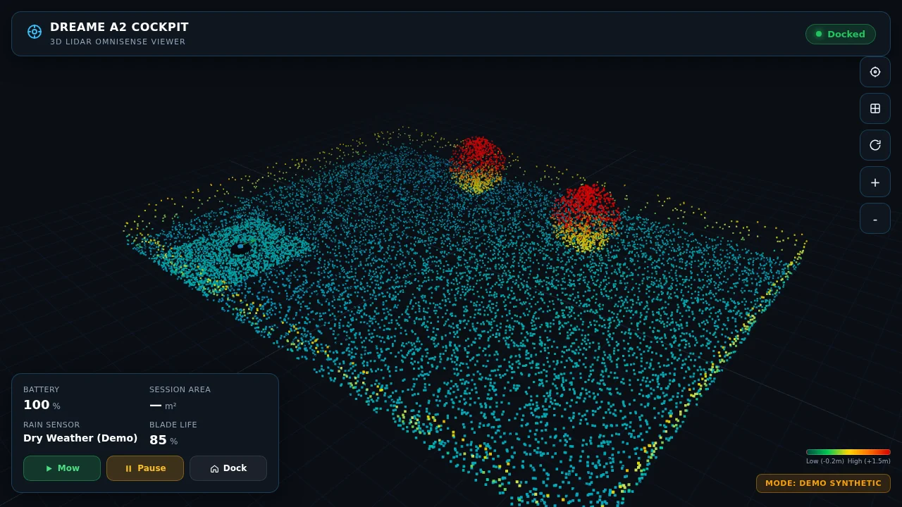

# Dreame A2 - 3D LiDAR WebGL Cockpit & Home Assistant Bridge

[](LICENSE)
[](https://www.python.org/)
[](https://threejs.org/)
[](https://www.home-assistant.io/)

Interactive **3D LiDAR `.pcd` point-cloud viewer** (offline Three.js r160 ES modules) and decoupled **FastAPI telemetry bridge** for the **Dreame Roboticmower A2** (OmniSense 2.0) and Home Assistant.

- **French version:** [`README.fr.md`](README.fr.md) · **Changelog:** [`CHANGELOG.md`](CHANGELOG.md) · **Full write-up:** [blog.ravindra-job.fr](https://blog.ravindra-job.fr/iot/dreame-a2-lidar-3d-pcd-passerelle-zero-trust-meteo-pluie/)



## What It Does

- **Offline 3D Point Cloud Viewer:** Renders `.pcd` LiDAR maps in WebGL with locally vendorized `three@0.160.0` + `OrbitControls` (zero external CDN calls), elevation heatmap, and mower dock marker.
- **Live Telemetry HUD:** Battery, session mowed area, blade life, and decoupled physical rain sensor status via Home Assistant REST API.
- **Fail-Closed Command Controls:** Start, Pause, and Dock refuse live execution (`HTTP 503`) unless `API_AUTH_TOKEN` is set alongside `HA_TOKEN`, verified via constant-time `hmac.compare_digest` + explicit CORS allowlist.
- **Zero-PII Demo Mode:** Ships with a 15,000-point procedural garden (`scripts/generate_synthetic_pcd.py`), no mower or real property geometry required.

```text
Home Assistant (dreame_lawn_mower) ──REST──▶ FastAPI Backend (:8000) ──HTTP──▶ Offline Three.js 3D Cockpit / Lovelace iframe
```

## Quick Start (Prebuilt Image or Build From Scratch)

### Option 1 - Prebuilt Multi-Arch Docker Image (`amd64` + `arm64`, 3 seconds)

```bash
docker run --rm -p 127.0.0.1:8000:8000 ghcr.io/ravindrajob/dreamea2:latest
# Open http://127.0.0.1:8000 (runs synthetic demo out of the box)
```

### Option 2 - Rebuild From Scratch (Docker Compose or Standalone Python)

```bash
git clone https://github.com/ravindrajob/dreameA2.git && cd dreameA2
cp .env.example .env            # set HA_URL, HA_TOKEN, API_AUTH_TOKEN (optional in demo)
docker compose up -d --build    # builds locally from Dockerfile (or omit --build to pull GHCR)
# Standalone Python + tests:
python3 -m venv .venv && source .venv/bin/activate
pip install -r backend/requirements.txt pytest && pytest tests/
python3 backend/main.py         # binds to 127.0.0.1:8000 by default
```

## Field Notes & Lessons Learned

- **Real LiDAR privacy trap:** A mower `.pcd` scan exposes exact property boundaries and house footprints. Keeping `web/assets/*_real.pcd` gitignored and shipping a deterministic procedural generator avoids leaking home geometry while keeping the viewer testable.
- **Three.js r160 breaking change:** Upstream removed UMD `examples/js/controls/OrbitControls.js`. Vendorizing `three.module.min.js` + `OrbitControls.js` with an importmap fixed both the CDN 404 and offline Lovelace iframe loading.
- **Loopback vs Docker bind:** `backend/main.py` defaults to `127.0.0.1` so standalone runs never expose physical mower controls on the LAN; `Dockerfile` sets `ENV HOST=0.0.0.0` while `docker-compose.yml` pins host publication to `127.0.0.1:8000:8000`.
- **Workflow note:** Built, tested, and iterated on a physical Dreame A2 + Home Assistant setup; AI tools assisted with security review, edge-case tests, and documentation cleanup. See [`CHANGELOG.md`](CHANGELOG.md).

## Home Assistant Lovelace Card & Security

- Lovelace iframe stack example: [`lovelace/dreame_a2_card.yaml`](lovelace/dreame_a2_card.yaml) · CI/Release workflow: [`.github/workflows/ci-release.yml`](.github/workflows/ci-release.yml).
- Hardened container (`appuser`, `cap_drop: [ALL]`, `no-new-privileges:true`) and active PII/RFC-1918 scanner (`./scripts/verify_zero_pii.sh`).
- Compatible with [okolbu/ha-dreame-a2-mower](https://github.com/okolbu/ha-dreame-a2-mower) · Licensed under [MIT](LICENSE) - **Ravindra JOB**.
